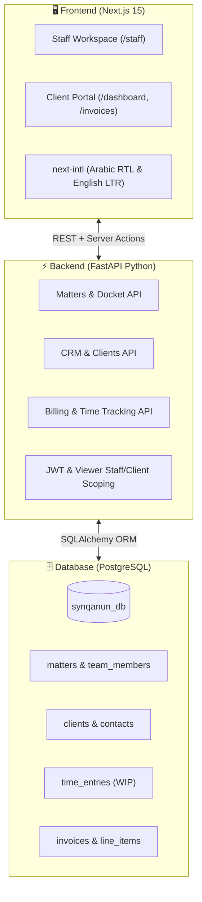

# SynQanun Suite (منصة سن قانون)
### Bilingual Legal Practice Management & Client Portal Platform

**SynQanun Suite** is an enterprise-grade, bilingual (**Arabic / English**, **RTL / LTR**) legal practice management system and client portal designed for premier law firms and corporate legal departments.

This repository implements **Track A.5 (Production Database Integration & Backend Persistence)**: replacing prototype mock fixtures with a real **PostgreSQL** relational database, **FastAPI** REST backend, and **Next.js 15** App Router frontend with strict role-based access control (RBAC).

---

## 🏛️ Architecture Overview



* **Frontend:** Next.js 15, React 19, Server Components & Server Actions, Tailwind CSS, `next-intl` bilingual localization.
* **Backend:** FastAPI, Python 3.11+, SQLAlchemy ORM, Pydantic v2 schemas, OAuth2 / Bearer JWT security.
* **Database:** PostgreSQL (`synqanun_db`) with relational integrity and transactional audit trails.

---

##  Key Achievements & Delivered Modules (ما تم إنجازه)

### 1. إدارة العملاء وسجل الموكلين (CRM & Client Management)
* **Real PostgreSQL Database Persistence:** Replaced fixture data with persistent client profiles, commercial register numbers, and corporate standings.
* **Client Financial & Legal Metrics:** Automated calculation of outstanding balances, retainer standings, and active linked matters.
* **Client Portal Scoping:** Strict tenant-safe isolation ensuring client accounts only view their authorized documents and dockets.

### 2. المسائل والقضايا القانونية وسجل الجلسات (Legal Matters & Docket Register)
* **Complete Legal Lifecycle:** Full tracking for commercial litigation, arbitration (CRCICA), regulatory compliance, and tax appeals.
* **Hearings & Timeline Management:** Derived next hearing countdowns, procedural milestones, and official court file numbers.
* **Bulk Lead Reassignment:** Bulk file transfer workflow with eligibility validation (restricted to Partners and Senior Associates).
* **Docket Archiving & Reopening:** Formal archival and Partner-only reopening mechanisms with persistent audit timestamps.

### 3. بوابة الموكلين التفاعلية (Client Experience Portal)
* **Dedicated Client Workspace:** Clients view case updates, court hearing schedules, and corporate records in real time.
* **Direct Communication & Review:** Instant access to expert memoranda, hearing dates, and billing statements.

### 4. الفوترة والمطالبات المالية وتسجيل الوقت (Billing, Invoicing & Time Tracking)
* **Floating Billable Timer Widget (`TimerPill` & `TimerLogModal`):**
  * Persistent global timer available across all staff workspaces.
  * Stop-and-log workflow allowing attorneys to log time directly against active legal matters.
  * Live matter dropdown pre-populated from PostgreSQL with full Arabic and English labels.
* **Automated Hourly Rates:**
  * Dynamic rate calculation mapped to staff ranks (Partner: 3,500 EGP/hr, Senior Associate: 2,200 EGP/hr, etc.).
  * Categorization of time into billable WIP vs. non-chargeable work.
* **Invoice Builder (`/staff/billing/new`):**
  * Automatically aggregates unbilled logged time entries for any selected matter.
  * Allows adding manual disbursement line items (court fees, courier, expert expenses).
* **Direct Official Issuance ("إرسال إلى العميل"):**
  * Converts drafts directly into active claims (`status = due`) in PostgreSQL.
  * Invoices immediately appear on the client portal (`/invoices`) and under the matter's fee records.
  * Automatically flags associated time entries as billed to prevent double-billing.

### 5. الصلاحيات والأمان (Role-Based Access Control - RBAC)
* **Partner (شريك):** Full administrative and financial control (view ledger, issue invoices, mark invoices paid, reopen closed matters).
* **Senior Associate (محامٍ أول):** Access to billing ledger, time logging, draft creation, and invoice issuance.
* **Junior Associate & Paralegal (محامٍ مشارك / مساعد قانوني):** Permitted to record billable time only; financial ledger and invoice creation are strictly blocked.
* **Legal Secretary (سكرتير قانوني):** Administrative tasks only; billable timer is suppressed, and billing access is restricted.

---

## 🚀 Getting Started (دليل التشغيل)

### 1. Prerequisites
* **Node.js** 18.18+ & **npm**
* **Python** 3.11+
* **PostgreSQL** 14+ running locally on port 5432

### 2. Database Configuration
Create the PostgreSQL database and user:
```sql
CREATE DATABASE synqanun_db;
CREATE USER postgres WITH PASSWORD 'postgres';
GRANT ALL PRIVILEGES ON DATABASE synqanun_db TO postgres;
```

### 3. Backend Setup (FastAPI)
```bash
cd backend
python -m venv venv

# Windows
.\venv\Scripts\activate
# Linux / macOS
source venv/bin/activate

pip install -r requirements.txt
cp .env.example .env

# Run FastAPI Server
uvicorn app.main:app --reload --port 8000
```
Backend API will be live at `http://127.0.0.1:8000` (Swagger docs: `/docs`).

### 4. Frontend Setup (Next.js)
```bash
cd SynQanun-Suite--claude-busy-euler-fyv6xy
npm install
npm run dev
```
Frontend will be live at `http://localhost:3000`.

---

## 🧪 Automated Testing & Verification

Run the automated audit test suite to verify PostgreSQL persistence and billing workflows:
```bash
python audit_module4.py
```

Expected output:
```text
--- AUDITING MODULE 4: BILLING & INVOICING + TIME TRACKING ---
  [PASS] 1. GET /staff/billing/summary
  [PASS] 2. GET /staff/billing/invoices
  [PASS] 3. GET /staff/billing/quotes
  [PASS] 4. GET /staff/billing/time
  [PASS] 5. GET /staff/billing/context
  [PASS] 6. POST /staff/billing/time
  [PASS] 7. POST /staff/billing/drafts
  [PASS] 8. POST /staff/billing/invoices/{ref}/issue
  [PASS] 9. POST /staff/billing/invoices/{ref}/mark-paid
  [PASS] 10. GET /client/invoices
  [PASS] 11. GET /client/invoices/summary
  [PASS] 12. GET /client/invoices/{ref}

AUDIT COMPLETE: 12 PASSED, 0 FAILED
```

---

## 📄 License
Proprietary & Confidential — Developed for SynQanun Legal Solutions.
