# SynQanun Suite (منصة سُنّة القانون)
### Bilingual Enterprise Legal Practice Management & Client Portal Platform

**SynQanun Suite** is an enterprise-grade, bilingual (**Arabic / English**, **RTL / LTR**) legal practice management system and client portal designed for premier law firms, dispute resolution practices, and corporate legal departments.

This repository implements **Track A.5 (Production Database Integration & Backend Persistence)**: replacing prototype mock fixtures with a real **PostgreSQL** relational database, **FastAPI** REST backend, and **Next.js 15** App Router frontend with strict role-based access control (RBAC).

---

## 🏛️ Architecture Overview

```mermaid
flowchart TD
    subgraph ClientLayer["🖥️ Frontend (Next.js 15 - App Router)"]
        StaffApp["Staff Workspace (/staff)"]
        ClientPortal["Client Portal (/dashboard, /invoices, /documents)"]
        AuthGateways["Dual Gateways (/gateway/firm & /gateway/client)"]
        DocCanvas["Dedicated Word Canvas (/staff/documents/draft)"]
        LegalDBUI["Legal Precedents UI (/staff/legal-database)"]
        I18n["next-intl (Arabic RTL & English LTR)"]
    end

    subgraph APILayer["⚡ Backend (FastAPI Python 3.11+)"]
        AuthAPI["Authentication & RBAC Middleware"]
        MattersAPI["Matters & Docket API (/staff/matters, /client/matters)"]
        ClientsAPI["CRM & Clients API (/staff/clients)"]
        BillingAPI["Billing & Time Tracking API (/staff/billing, /client/invoices)"]
        DocsAPI["Documents & MS Graph API (/documents, /integrations)"]
        LegalDBAPI["Legal Database API (/staff/legal-database)"]
        UsersAPI["Team & Roster API (/staff/users)"]
    end

    subgraph DataLayer["🗄️ Database (PostgreSQL - synqanun_db)"]
        DB[(PostgreSQL)]
        T1["users & firm_roster"]
        T2["clients & client_contacts"]
        T3["matters, hearings & timeline_events"]
        T4["time_entries (WIP & Rates)"]
        T5["invoices & invoice_line_items & quotes"]
        T6["documents & integrations"]
        T7["legal_database_entries (Cassation & Court Decisions)"]
    end

    ClientLayer <-->|REST + Server Actions| APILayer
    APILayer <-->|SQLAlchemy ORM| DataLayer
```



* **Frontend:** Next.js 15 (App Router), React 19, Server Components & Server Actions, Tailwind CSS, `next-intl` bilingual localization (RTL/LTR).
* **Backend:** FastAPI, Python 3.11+, SQLAlchemy ORM, Pydantic v2 schemas, OAuth2 / Bearer JWT security.
* **Database:** PostgreSQL (`synqanun_db`) with relational modeling, foreign keys, and transactional audit trails.

---

## 🚀 ما تم إنجازه تفصيلياً (Delivered Modules & Features)

### 1. نظام المصادقة والأمان الصارم وبوابات الدخول (Authentication & Security Hardening)
* **بوابتان منفصلتان للدخول (Dual Login Gateways):**
  * **بوابة المكتب والمحامين (`/gateway/firm`):** مخصصة لفريق العمل القانوني والمحامين والشركاء لتسجيل الدخول إلى مساحة العمل الإدارية.
  * **بوابة الموكلين (`/gateway/client`):** بوابة مستقلة لعملاء المكتب لمتابعة قضاياهم ومواعيد جلساتهم وسداد فواتيرهم.
* **المصادقة الحقيقية بالـ Bearer JWT وتخزين HttpOnly الآمن:**
  * اعتماد مصادقة قائمة على **JWT Bearer Tokens** مع حقل claim صريح لنوع التوكن (`"typ": "access"`).
  * تخزين التوكن في كوكي `syn-auth-token` آمن (`HttpOnly`, `SameSite=Lax`, `Secure` في الإنتاج)، مما يمنع سرقة الجلسات عبر ثغرات XSS.
  * إلغاء انتحال الشخصيات عبر ترويسات `X-Viewer-*` وإلزام تمرير التوكن الموثق، مع حظر تشغيل الخادم نهائياً في بيئة الإنتاج (`ENVIRONMENT=production`) إذا كان إعداد `ALLOW_VIEWER_HEADERS` مفعلاً.
* **حماية التخطيطات والعزل بين الكادر والموكلين (Layout Protection & Cross-Portal Isolation):**
  * فحص مسارات `(staff)` بالكامل؛ أي محاولة دخول بدون كوكي أو بحساب موكل تحول المستخدم تلقائياً برمز `307` إلى بوابة المكتب `/gateway/firm`.
  * فحص مسارات `(client)` بالكامل؛ أي محاولة دخول بدون كوكي أو بحساب موظف تحول المستخدم تلقائياً برمز `307` إلى بوابة الموكل `/gateway/client`.
* **محدد معدل الطلبات وحماية الهجمات العنيفة (In-Memory Sliding Window Rate Limiting):**
  * تطبيق محدد لمعدل الطلبات في الذاكرة على بوابات تسجيل الدخول واستعادة كلمة المرور (5 محاولات فاشلة خلال 15 دقيقة تقفل الحساب مع ترويسة `429 Too Many Requests` و `Retry-After`).
* **استعادة كلمة المرور وإدارتها (Secure Password Reset):**
  * إرجاع نفس الاستجابة الموحدة الحيادية للبريد المسجل وغير المسجل لمنع استكشاف وتخمين حسابات المستخدمين (User Enumeration Defense) مع حظر تسريب التوكن للعميل نهائياً.
  * توكنات الاستعادة مميزة بـ `"typ": "reset"` وصلاحية 15 دقيقة، وتُرفض تلقائياً إن استُخدمت كتوكنات وصول.
* **إغلاق وثائق Swagger/OpenAPI في بيئة الإنتاج:**
  * حجب مسارات التوثيق التفاعلي (`/docs`, `/redoc`, `/openapi.json`) تلقائياً عند ضبط `ENVIRONMENT=production`.

---

### 2. إدارة العملاء وسجل الموكلين (CRM & Client Management)
* **قاعدة بيانات حقيقية للموكلين (PostgreSQL CRM):**
  * استبدال كافة البيانات الوهمية بجداول دائمة للشركات والمؤسسات والأفراد.
  * فحص منع تكرار أسماء العملاء (`409 Conflict`) مع دعم الحروف البرية والبحث الدقيق.
* **المؤشرات المالية والقانونية للعميل (Client Dashboard & Metrics):**
  * حساب آلي لحظي للرصيد المستحق (Balance Due)، الفواتير قيد الاستحقاق، والقضايا النشطة المرتبطة بكل عميل.
  * احتساب النشاط الأخير للموكل ديناميكياً بناءً على آخر تحديث في قضاياه وفواتيره ومستنداته وساعاته.
* **سجل جهات الاتصال التابع للعميل (`Client Contacts`):**
  * إدارة قائمة مسؤولي الاتصال والمديرين المعتمدين لدى الشركات الموكلة بصلاحيات تقتصر على الشركاء والمحامين الأوائل.
* **الملف الشامل للموكل:**
  * صفحة متكاملة لكل عميل تجمع قضاياه، خطوطها الزمنية، فواتيره، مستنداته المشتركة، وسجل الاعتمادات بدون أي استعلامات $N+1$.

---

### 3. المسائل والقضايا القانونية وسجل الجلسات (Legal Matters & Docket Register)
* **دورة الحياة الكاملة للمسائل القضائية:**
  * دعم وتصنيف مجالات الممارسة: النزاعات التجارية (Commercial Litigation)، التحكيم (CRCICA)، حوكمة الشركات والتراخيص، والطعون الجمركية والتنفيذ.
  * تسجيل بيانات المحكمة المختصة، الدائرة، والجهة القضائية بدقة.
  * ترقيم فريد غير متكرر للقضايا عبر كافة المكاتب (صيغة `MAT-####`).
* **إدارة الجلسات ومواعيد المحاكم (`Court Hearings & Key Dates`):**
  * جدول زمني دقيق لجلسات المرافعة وحجز الدعوى للحكم مع تصحيح احتساب الأيام (يوم الجلسة يعطي `0 days`).
  * تنبيه المحامين بالجلسات الحرجة الواقعة خلال 14 يوماً.
* **الخط الزمني الإجرائي للملف (`Procedural Timeline`):**
  * توثيق الوقائع والإجراءات وتقديم المذكرات ومباشرة مأموريات الخبراء لحظة بلحظة مع حجب الأحداث الإدارية عن بوابة الموكل.
* **نقل وتوزيع المسؤولية عن القضايا (`Lead Reassignment`):**
  * صلاحية حصرية للشركاء (`Partner`) لنقل الإشراف على القضايا مع الحفاظ على المحامي القديم كعضو بالفريق وتوثيق قرار النقل في الخط الزمني.
* **الأرشفة وإعادة الفتح بقرار الشريك (`Close & Reopen`):**
  * منع الانتقال لحالات غير صالحة (`409 Conflict`) وتوثيق إعادة الفتح بأوصاف حيادية رسمية.

---

### 4. الفوترة والمطالبات المالية وتسجيل الوقت (Billing, Invoicing & Time Tracking)
* **المؤقت الذكي وتسجيل الساعات:**
  * تسجيل ساعات العمل الفعلي مع احتساب التكلفة آلياً بناءً على رتبة المحامي.
  * التمييز التام بين القضايا (`matter`) والمشاريع الاستشارية (`project` للمسائل من نوع `otherProject`).
* **حماية النزاهة المالية ومنع الفوترة المزدوجة:**
  * فحص شامل ومطابقة صارمة لكافة قيود الوقت المرتبطة بالفاتورة قبل إنشائها.
  * قفل بنود الوقت بآلية `with_for_update()` داخل معاملة موحدة تمنع إنشاء فاتورتين متزامنتين لنفس ساعات العمل.
* **ترقيم الفواتير وحالاتها:**
  * ترقيم تسلسلي تراكمي فريد بصيغة `INV-YYYY-###` مقاوم للاصطدامات ومحاولات التكرار.
  * تحويل الفواتير المستحقة تلقائياً إلى حالة متأخرة (`overdue`) عند حلول تاريخ الاستحقاق.
* **عروض الأسعار الديناميكية (`Quotes`):**
  * ربط عروض الأسعار بالمحامي المسؤول عن الملف بدلاً من الأسماء الثابتة.
* **عزل فواتير الموكلين وحمايتها:**
  * قصر مسارات فواتير الموكلين على حسابات الموكلين فقط (`403 Forbidden` للكادر)، مع عزل تام يمنع وصول موكل مكتب لفواتير مكتب آخر (`404 Not Found`).

---

### 5. توليد وتصدير ملفات Word (.docx) و Excel (.xlsx) والمستندات الرسمية
* **صياغة وتوليد مستندات Word رسمية (.docx):**
  * **مذكرات الدفاع والدفوع القضائية:** توليد مذكرات دفاع بتنسيق RTL متضمنة أطراف الخصومة، الوقائع، الدفوع، والمواد القانونية.
  * **عقود تقديم الخدمات القانونية والأتعاب:** صياغة اتفاقيات التمثيل وجداول الأتعاب والالتزامات.
  * **التكليفات والتفويضات الرسمية:** خطابات تمثيل ومباشرة إجراءات.
* **شاشة محرر ومسودة Word المخصصة (`/staff/documents/draft`):**
  * مساحة صياغة تفاعلية (A4 Canvas) تدعم تنسيق RTL وضبط الهوامش وهوية المكتب.
* **التكامل مع Microsoft Word Online و OneDrive:**
  * إمكانية فتح المستند في Microsoft Word Online عبر `Microsoft Graph API` ودعم المزامنة السحابية.
* **تصدير جداول Excel مالية تفاعلية (.xlsx):**
  * كشف حساب موكل رسمي (Statement of Account).
  * سجل فواتير المسألة القانونية (Invoices Ledger).
  * تقرير ساعات العمل والمطالبات (Timesheet & Work Claims) بتنسيق RTL رسمي وألوان معتمدة.
* **حفظ دائم وتأمين التنزيل والمعاينة (Secure Document Streaming & Storage):**
  * حفظ كافة الملفات في جدول `documents` مع تشفير أسماء الملفات وتطبيق معيار RFC 5987 للأسماء العربية.
  * **تأمين مسارات المعاينة والتنزيل:** إلزام التحقق من ملكية المستند للمكتب أو الموكل صاحب القضية (مع حجب المستندات الداخلية `is_firm_only` عن الموكلين) وإرجاع `404` عند المنع لمنع استكشاف المعرفات.
  * **Next.js Streaming Proxy Routes:** إنشاء مسارات وسيطة (`/api/docs/[id]/download` و `/api/docs/[id]/preview`) تقرأ كوكي `HttpOnly` الآمن وتبث الملفات مباشرة للمتصفح دون تعريض التوكن للواجهة الأمامية.
  * **فحص البايتات السحرية وحجم الملفات المرفوعة (ZIP Magic Bytes & Size Validation):**
    * حظر رفع أي ملفات تتجاوز 10 ميجابايت (`MAX_UPLOAD_SIZE_MB`).
    * التحقق الصارم من البايتات السحرية للأرشيفات المضغوطة `b"PK\x03\x04"` في ملفات `.docx` و `.xlsx` لمنع رفع أي ملفات نصية أو برمجية ضارة منتحلة للامتداد.
  * **تحصين تكامل Microsoft Word Online و OAuth:**
    * اشتراط إصدار تذكرة دخول موقعة وموثقة مسبقاً (`POST /api/staff/integrations/microsoft/ticket`) صالحة لـ 5 دقائق فقط لبدء عملية الربط.
    * تشفير معامل الحالة `state` كتوكن JWT موقع رقمياً يحتوي على عشوائية `nonce` وتاريخ صلاحية (10 دقائق) ومسار العودة `return_to` المنظف ضد هجمات الـ Open Redirects.
    * ربط التوكنات وتحديثات التكامل بمكتب المستخدم المستخرج من التوكن الموقع حصرياً ومنع تسريب أي رسائل خطأ داخلية `str(e)`.

---

### 6. القاعدة القانونية وسجل المبادئ القضائية (Legal Database & Precedents) ⚖️
* **مستودع المبادئ والسوابق القضائية:**
  * أرشفة الأحكام والمبادئ الصادرة عن محكمة النقض (الدائرة التجارية) والمحاكم الاقتصادية ومراكز التحكيم (CRCICA).
  * ربط الأحكام بالكلمات الدلالية والتصنيفات القضائية ونصوص القوانين ذات الصلة.
* **واجهة بحث واستعراض متقدمة (`/staff/legal-database`):**
  * استعراض بطاقات الأحكام، تفاصيل منطوق الحكم، والمبادئ القانونية المستخلصة مع إمكانية البحث الفوري والفلترة بالجهة وسنة الصدور.

---

### 7. إدارة فريق العمل وتوزيع الصلاحيات (Team & User Management)
* **سجل فريق العمل (`/staff/settings/team`):**
  * إدارة بيانات المحامين والموظفين (الاسم، البريد، الرتبة، الحالة، الصلاحيات).
* **إصدار كلمات المرور المؤقتة:**
  * إضافة أعضاء جدد برتبهم المعتمدة وتعيين كلمات مرور مؤقتة وتفعيل/إيقاف الحسابات.
* **مصفوفة الصلاحيات الهرمية الصارمة (RBAC Matrix):**

| الدرجة الوظيفية | تسجيل الوقت (المؤقت) | الاطلاع على الفوترة المالية | إعداد واعتماد الفواتير | أرشفة وإعادة فتح القضايا | نقل المحامي المسؤول |
| :--- | :---: | :---: | :---: | :---: | :---: |
| **الشريك (Partner)** |  نعم |  نعم (صلاحية مالية شاملة) |  نعم (إصدار واعتماد وتسجيل السداد) |  نعم (صلاحية حصرية) |  نعم (صلاحية حصرية) |
| **المحامي الأول (Senior Associate)** |  نعم |  نعم (دفتر الفوترة والمطالبات) |  نعم (إعداد وإرسال الفواتير) | ❌ لا (تحتاج شريكاً) | ❌ لا (تحتاج شريكاً) |
| **المحامي المشارك (Junior Associate)** |  نعم (ساعاته فقط) | ❌ **محظور تماماً** | ❌ **محظور تماماً** | ❌ محظور | ❌ محظور |
| **المساعد القانوني (Paralegal)** |  نعم (ساعاته فقط) | ❌ **محظور تماماً** | ❌ **محظور تماماً** | ❌ محظور | ❌ محظور |
| **السكرتارية القانونية (Legal Secretary)** | ❌ **المؤقت محجوب** | ❌ **محظور تماماً** | ❌ **محظور تماماً** | ❌ محظور | ❌ محظور |
| **الموكل (Client)** | ❌ محجوب |  نعم (فواتيره وسجلاته فقط) | ❌ محظور | ❌ محظور | ❌ محظور |

---

## ⚡ تحسين الأداء وإلغاء استعلامات N+1 (Performance Optimization)
تم إجراء مسح وتطوير شامل لكافة نقاط النهاية السبع الرئيسية في النظام وإلغاء الاستعلامات المتكررة (N+1 queries) عبر الاستعلام المجمع المسبق (Batch Preloading) والتجميع في الذاكرة:
1. `GET /api/staff/billing/invoices`
2. `GET /api/staff/billing/drafts`
3. `GET /api/staff/billing/quotes`
4. `GET /api/staff/billing/time`
5. `GET /api/staff/billing/summary`
6. `GET /api/client/invoices`
7. `GET /api/staff/matters`

**النتيجة:** انخفاض عدد الاستعلامات من عشرات الاستعلامات المتكررة إلى 2 - 4 استعلامات مجمعة في كل طلب، مع تطابق مخرجات الـ JSON بنسبة 100% مع الـ Baseline قبل التحسين.

---

## 🧪 جناح الاختبارات الآلية والتحقق الأمني (Comprehensive Test Suites)

يتضمن المشروع 11 جناح اختبارات آلية تغطي كافة جوانب النظام والتحصين الأمني:

```bash
# 1. اختبارات المصادقة الحقيقية Bearer JWT وحماية المستندات وتذاكر OAuth:
python backend/tests/test_bearer_auth_and_document_security.py

# 2. اختبارات التحصين الأمني الشامل (Rate Limiting, Reset Enumeration, RBAC, Open Redirect):
python tests/test_security_fixes.py

# 3. اختبارات فحص وتغطية كافة الـ 60 API endpoints:
python tests/test_all_60_apis.py

# 4. اختبارات سلامة القضايا، الترقيم المتسلسل، ومنطق الحسابات:
python tests/test_matters_and_billing_robustness.py

# 5. اختبارات التحقق من عروض الأسعار، صلاحيات الموكل، والتحسين N+1:
python tests/test_quotes_client_auth_and_n1.py

# 6. اختبارات مسودات الفواتير، بنود الوقت، وقفل المعاملات:
python tests/test_billing_drafts_and_time.py

# 7. اختبارات تحسين الموكلين، النشاط الأخير، وبطاقات CRM:
python tests/test_clients_n1_and_last_activity.py

# 8. اختبارات التحقق من صحة بيانات الموكلين ومنع التكرار:
python tests/test_clients_validation.py

# 9. اختبارات التواريخ، الفواتير المتأخرة، ومواعيد الجلسات:
python tests/test_dates_overdue_and_hearings.py

# 10. اختبارات دورة حياة الفواتير والحجب عن الموكل:
python tests/test_invoice_transitions_and_visibility.py

# 11. اختبارات مصفوفة صلاحيات القضايا والخط الزمني:
python tests/test_matter_permissions_and_timeline.py
```

* **Zero DB Leak:** كافة ملفات الاختبار تقوم بتنظيف الكيانات المنشأة وتضمن عودة أعداد جداول قاعدة البيانات لما كانت عليه تماماً.
* **Revert Check Verified:** تم إثبات فشل الاختبارات عند استرجاع الكود القديم ونجاحها فور تطبيق التعديلات.

---

## 💻 دليل التثبيت والتشغيل المحلي (Setup & Run Guide)

### 1. المتطلبات الأساسية
* **Node.js** الإصدار 18.18 فما فوق و **npm**
* **Python** الإصدار 3.11 فما فوق
* خادم **PostgreSQL** يعمل محلياً على المنفذ `5432`

### 2. إعداد قاعدة البيانات
```sql
CREATE DATABASE synqanun_db;
CREATE USER postgres WITH PASSWORD 'postgres';
GRANT ALL PRIVILEGES ON DATABASE synqanun_db TO postgres;
```

### 3. تشغيل الواجهة الخلفية (FastAPI Backend)
```bash
cd backend
python -m venv venv

# تفعيل البيئة الافتراضية
# Windows PowerShell:
.\venv\Scripts\activate
# Linux / macOS:
source venv/bin/activate

# تثبيت المكتبات المطلوبة
pip install -r requirements.txt
cp .env.example .env

# تعبئة البيانات الأولية التجريبية
python -c "from app.seed import seed; seed()"

# تشغيل خادم FastAPI
uvicorn app.main:app --reload --port 8000
```
سيكون خادم الـ API متاحاً على الرابط: `http://127.0.0.1:8000` (وتوثيق Swagger التفاعلي على `/docs`).

### 4. تشغيل الواجهة الأمامية (Next.js Frontend)
```bash
cd SynQanun-Suite--claude-busy-euler-fyv6xy
npm install
npm run dev
```
ستكون الواجهة الأمامية متاحة على الرابط: `http://localhost:3000`.

### 5. التحقق من بناء الإنتاج (Production Build Check)
```bash
cd SynQanun-Suite--claude-busy-euler-fyv6xy
npm run build
# يولد 100/100 صفحة ثابتة وديناميكية بنجاح تام وبدون أي أخطاء أنواع
```

---

## ⏳ خارطة الطريق للإطلاق الإنتاجي (Production Roadmap)
* [ ] ربط الصفحات المتبقية في بوابة الموكل مباشرة بالـ Backend بدلاً من محاكي Mock.
* [ ] ربط خدمة بريد إلكتروني حقيقي (SMTP / Resend / SendGrid) لدعوات الموكلين واستعادة كلمة المرور.
* [ ] ربط بوابة دفع إلكتروني (Paymob / Fawry / Stripe) لسداد فواتير الموكلين أونلاين.
* [ ] نقل تخزين المستندات إلى وحدة تخزين سحابية مخصصة (AWS S3 / Azure Blob Storage).
* [ ] إعداد ملفات النشر الإنتاجي (Docker & Nginx مع شهادات SSL/HTTPS و Rate Limiting).

---

## 📄 الترخيص (License)
جميع الحقوق محفوظة © لمنصة سن قانون (SynQanun Legal Practice Management Solutions).
