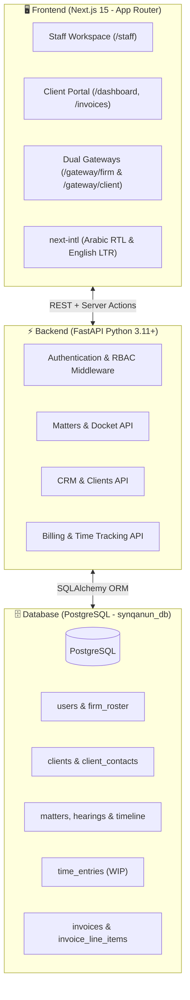

# SynQanun Suite (منصة سن قانون)
### Bilingual Legal Practice Management & Client Portal Platform

**SynQanun Suite** is an enterprise-grade, bilingual (**Arabic / English**, **RTL / LTR**) legal practice management system and client portal designed for premier law firms, dispute resolution practices, and corporate legal departments.

This repository implements **Track A.5 (Production Database Integration & Backend Persistence)**: replacing prototype mock fixtures with a real **PostgreSQL** relational database, **FastAPI** REST backend, and **Next.js 15** App Router frontend with strict role-based access control (RBAC).

---

## 🏛️ Architecture Overview



* **Frontend:** Next.js 15, React 19, Server Components & Server Actions, Tailwind CSS, `next-intl` bilingual localization.
* **Backend:** FastAPI, Python 3.11+, SQLAlchemy ORM, Pydantic v2 schemas, OAuth2 / Bearer JWT security.
* **Database:** PostgreSQL (`synqanun_db`) with relational modeling, foreign keys, and transactional audit trails.

---

## 🚀 ما تم إنجازه تفصيلياً (Delivered Modules & Features)

### 1. نظام المصادقة وبوابات الدخول (Authentication & Dual Gateways)
* **بوابتان منفصلتان للدخول (Dual Login Gateways):**
  * **بوابة المكتب والمحامين (`/gateway/firm`):** مخصصة لفريق العمل القانوني والمحامين والشركاء لتسجيل الدخول إلى مساحة العمل الإدارية.
  * **بوابة الموكلين (`/gateway/client`):** بوابة مستقلة لعملاء المكتب لمتابعة قضاياهم ومواعيد جلساتهم وسداد فواتيرهم.
* **الأمان والعزل الكامل للمستأجرين (Tenant & Client Isolation):**
  * اعتماد مصادقة قائمة على **JWT (JSON Web Tokens)** و OAuth2.
  * تطبيق وسيط آمن (`X-Viewer-Staff-Id` و `X-Viewer-Client-Id`) لضمان عدم اطلاع أي موكل إلا على قضاياه وفواتيره الخاصة به فقط.
* **أداة التبديل التجريبي السريع للدرجات الوظيفية (Demo Viewer Switcher):**
  * إتاحة أداة مدمجة بأعلى الواجهة تتيح التبديل الفوري بين الدرجات الوظيفية الخمس (`Partner`، `Senior Associate`، `Junior Associate`، `Paralegal`، `Legal Secretary`) لاختبار مصفوفة الصلاحيات والحجب بدقة دون الحاجة لتسجيل الخروج والدخول المتكرر.

---

### 2. إدارة العملاء وسجل الموكلين (CRM & Client Management)
* **قاعدة بيانات حقيقية للموكلين (PostgreSQL CRM):**
  * استبدال كافة البيانات الوهمية بجداول دائمة للشركات والمؤسسات والأفراد.
  * تسجيل بيانات السجل التجاري، الرقم الضريبي، وتصنيف العميل ونطاق التعاقد.
* **المؤشرات المالية والقانونية للعميل (Client Dashboard & Metrics):**
  * حساب آلي لحظي للرصيد المستحق (Balance Due)، الفواتير قيد الاستحقاق، والقضايا النشطة المرتبطة بكل عميل.
  * متابعة حالة العميل التعاقدية (عميل دائم بعقد سنوي Retainer، عميل نشط Active، أو عميل محتمل Prospect).
* **سجل جهات الاتصال التابع للعميل (`Client Contacts`):**
  * إدارة قائمة مسؤولي الاتصال والمديرين المعتمدين لدى الشركات الموكلة (الاسم، البريد الإلكتروني، الهاتف، والمنصب الإداري).
* **الملف الشامل للموكل:**
  * صفحة متكاملة لكل عميل تجمع قضاياه، خطوطها الزمنية، فواتيره، مستنداته المشتركة، وسجل الاعتمادات.

---

### 3. المسائل والقضايا القانونية وسجل الجلسات (Legal Matters & Docket Register)
* **دورة الحياة الكاملة للمسائل القضائية:**
  * دعم وتصنيف كافة مجالات الممارسة: النزاعات التجارية (Commercial Litigation)، التحكيم المحلي والدولي (CRCICA)، حوكمة الشركات والتراخيص الرقابية، والطعون الضريبية.
  * تسجيل بيانات المحكمة المختصة، الدائرة، والجهة القضائية (مثل: محكمة استئناف القاهرة التجارية، المحاكم الاقتصادية، مركز القاهرة للتحكيم).
  * قيد أرقام القضايا الرسمية، والخصوم والأطراف المقابلة، ومحامي الخصم.
* **إدارة الجلسات ومواعيد المحاكم (`Court Hearings & Key Dates`):**
  * جدول زمني دقيق لجلسات المرافعة، حجز الدعوى للحكم، وتقديم مذكرات الرد على تقارير الخبراء.
  * احتساب المواعيد القضائية القادمة وتنبيه المحامين بالجلسات الحرجة الواقعة خلال 14 يوماً.
* **الخط الزمني الإجرائي للملف (`Procedural Timeline`):**
  * توثيق الوقائع والإجراءات وتقديم المذكرات ومباشرة مأموريات الخبراء لحظة بلحظة مع ربطها بقاعدة البيانات.
* **نقل وتوزيع المسؤولية عن القضايا (`Bulk Lead Reassignment`):**
  * آلية مخصصة لنقل الإشراف على ملف أو عدة ملفات قانونية دفعة واحدة من محامٍ لآخر مع فحص أهليّة المحامي المسؤول وصلاحياته.
* **الأرشفة وإعادة الفتح بقرار الشريك (`Archiving & Reopening`):**
  * أرشفة القضايا المنتهية ونقلها إلى سجل الأرشيف.
  * صلاحية حصرية للشركاء (`Partner`) لإعادة فتح أي قضية مؤرشفة مع توثيق قرار إعادة الفتح وتحديث المرحلة الإجرائية في قاعدة البيانات.
* **شارات الحالة التفاعلية الذكية:**
  * تصنيف نبرة الحالة (`urgent`، `positive`، `neutral`) بما في ذلك شارة **"بانتظار الموكل"** لإبراز المسائل المتوقفة على اعتماد العميل.

---

### 4. الفوترة والمطالبات المالية وتسجيل الوقت (Billing, Invoicing & Time Tracking)
* **المؤقت العائم الذكي (`Floating Timer` & `TimerLogModal`):**
  * ويدجت عائم متاح ومستمر عبر كافة صفحات مساحة عمل المكتب لحساب زمن العمل الفعلي بدقة (ساعات، دقائق، ثوانٍ).
  * عند الإيقاف: تفتح نافذة تسجيل الوقت المنجز المرتبطة مباشرة بقائمة القضايا النشطة في PostgreSQL لاختيار القضية وحفظ ساعات العمل.
* **تسجيل ساعات العمل واحتساب التكلفة آلياً (Billable WIP):**
  * تصنيف الوقت إلى عمل قابل للفوترة للعميل (`Billable`) أو عمل إداري غير مفوتر.
  * احتساب التكلفة المالية تلقائياً بناءً على الرتبة الوظيفية للمحامي (الشريك: 3,500 ج.م/ساعة، المحامي الأول: 2,200 ج.م/ساعة، إلخ).
* **دفتر الفوترة المركزي للمكتب (`/staff/billing`):**
  * 4 بطاقات مؤشرات مالية رئيسية: المبالغ المستحقة غير المسددة، الفواتير المتأخرة، المصدر حديثاً، وعروض الأتعاب.
  * عرض كشوف الأتعاب، مسودات الفواتير، وسجل الساعات غير المفوترة.
* **منشئ الفواتير المتقدم (`InvoiceBuilder`):**
  * سحب ساعات العمل المسجلة على أي قضية آلياً وتحويلها إلى بنود واضحة ومفصلة في الفاتورة مع عدد الساعات ومعدل الأتعاب.
  * إمكانية إضافة مصروفات ورسوم محاكم ورسوم انتقال ومأموريات كبنود يدوية مستقلة.
* **خيارات الإصدار والحفظ:**
  * **"حفظ المسودة":** لحفظ الفاتورة كمسودة داخلية قيد المراجعة في المكتب دون إرسالها للعميل.
  * **"إرسال إلى العميل":** لاعتماد الفاتورة فورياً برقم تسلسلي رسمي وترحيلها كـ (`قيد الاستحقاق - due`) في PostgreSQL لتظهر مباشرة في بوابة الموكل وملف القضية مع تعليم ساعاتها بأنها مفوترة لمنع تكرار احتسابها.
* **تزامن كامل مع بوابة العميل (`/invoices`):**
  * يستطيع الموكل الاطلاع على فواتيره، مراجعة بنودها وتفاصيل العمل المنجز وسدادها فورياً.

---

### 5. توليد وتصدير ملفات Word (.docx) و Excel (.xlsx) والربط التلقائي بقاعدة البيانات (Module 5: Documents & Exports)
* **صياغة وتوليد مستندات Word رسمية (.docx):**
  * **مذكرات الدفاع والدفوع القضائية:** توليد مذكرات دفاع رسمية متوافقة 100% مع تنسيق القضاء العربي (RTL - من اليمين لليسار) متضمنة ترويسة المحكمة والدائرة، أطراف الخصومة وصفتهم، سرد الوقائع، الدفوع والأسانيد القانونية (استناداً لمواد القانون المدني والتجاري وأحكام النقض)، والطلبات الختامية وتوقيع المحامي الوكيل.
  * **عقود تقديم الخدمات القانونية والأتعاب:** صياغة اتفاقيات التمثيل والوكالة متضمنة ديباجة الأطراف، نطاق التمثيل، جدول الأتعاب، الالتزامات والسرية، والقانون الواجب التطبيق.
  * **التكليفات والتفويضات القانونية:** خطابات رسمية بتكليف وتفويض المحامين المساعدين بالحضور ومباشرة الإجراءات.
* **تصدير جداول Excel مالية وإدارية تفاعلية (.xlsx):**
  * **كشف حساب موكل رسمي (Statement of Account):** كشف حساب مالي تفصيلي بجميع الحركات والفواتير والمسددات واحتساب آلي للرصيد التراكمي وصافي المستحق.
  * **سجل فواتير المسألة القانونية (Invoices Ledger):** جدول مالي بالأتعاب، المبالغ قبل الضريبة، ضريبة القيمة المضافة (14%)، والإجمالي وحالة الفاتورة.
  * **تقرير ساعات العمل والمطالبات (Timesheet & Work Claims):** تفريغ كامل لقيود المؤقت الفعلي، أسماء المحامين، أسعار الساعات، والمبالغ القابلة للمطالبة.
  * **تنسيق احترافي:** تفعيل اتجاه الورقة من اليمين لليسار (`Right-to-Left Sheet View`)، ترويسات بلون كحلي وذهبي، حدود للخلايا، وتنسيق مالي للأرقام والعملة (`ج.م`).
* **الحفظ التلقائي والربط الدائم بقاعدة البيانات (Full PostgreSQL Persistence):**
  * عند توليد أي مستند أو تصدير أي جدول، يقوم النظام بتخزينه فوراً على السيرفر وإدراجه في جدول `documents` في قاعدة بيانات PostgreSQL.
  * يظهر الملف المُنشأ فوراً في قائمة "المستندات" داخل صفحة القضية لدى المحامي، وفي بوابة الموكل (`/documents` و `/matters/[ref]`) للتنزيل وإعادة الفتح في أي لحظة.
  * تسجيل حدث رسمي في الخط الزمني للمسألة القانونية يوثق توليد المستند بالاسم والتاريخ.

---

### 6. نظام الصلاحيات والأمان الهرمي (Role-Based Access Control - RBAC)
تم تطبيق نظام صلاحيات صارم يضمن أعلى معايير السرية للمكاتب القانونية:

| الدرجة الوظيفية | تسجيل الوقت (المؤقت) | الاطلاع على الفوترة المالية | إعداد واعتماد الفواتير للعملاء | أرشفة وإعادة فتح القضايا |
| :--- | :---: | :---: | :---: | :---: |
| **الشريك (Partner)** |  نعم |  نعم (صلاحية مالية شاملة) |  نعم (إصدار واعتماد وتسجيل السداد) |  نعم (صلاحية حصرية) |
| **المحامي الأول (Senior Associate)** |  نعم |  نعم (دفتر الفوترة والمطالبات) |  نعم (إعداد وإرسال الفواتير) | ❌ لا (تحتاج شريكاً) |
| **المحامي المشارك (Junior Associate)** |  نعم (ساعاته فقط) | ❌ **محظور تماماً** | ❌ **محظور تماماً** | ❌ محظور |
| **المساعد القانوني / الباحث (Paralegal)** |  نعم (ساعاته فقط) | ❌ **محظور تماماً** | ❌ **محظور تماماً** | ❌ محظور |
| **السكرتارية القانونية (Legal Secretary)** | ❌ **المؤقت محجوب** | ❌ **محظور تماماً** | ❌ **محظور تماماً** | ❌ محظور |

---

## ⏳ ما تبقى وقيد التطوير للمراحل القادمة (Pending Modules & Roadmap)

العمل جاد ومستمر لاستكمال باقي مكونات المنصة وفقاً لخطة التطوير، والموديولات المتبقية حصراً هي:

### 1. المساعد الذكي القانوني (معين - Mueen AI Assistant) 🤖
* **الدردشة القانونية الذكية:** التفاعل المباشر مع ملفات القضايا والوثائق القانونية المرفوعة.
* **التلخيص الآلي للوقائع:** استخلاص التسلسل الزمني للأحداث والمستندات في الدعاوى المعقدة.
* **تحليل المخاطر القضائية:** دراسة نقاط القوة والضعف في مذكرات الخصم وتقديم توصيات استراتيجية.
* **الصياغة الآلية:** مساعدة المحامين في الصياغة الأولية لصحف الدعاوى والعقود ومذكرات الدفاع.

### 2. القاعدة القانونية وأبحاث الأحكام (Legal Database & Precedents) ⚖️
* **مستودع السوابق القضائية:** أرشفة والبحث في مبادئ وأحكام محكمة النقض، المحكمة الإدارية العليا، والمحاكم الاقتصادية.
* **نصوص القوانين والتشريعات:** فهرسة القوانين واللوائح التنفيذية المصرية والعربية وربطها التلقائي بموضوعات القضايا.
* **محرك البحث الدلالي:** البحث بالمعنى والمصطلحات القانونية بدلاً من مجرد الكلمات المفتاحية المطابقة.

---

## 💻 دليل التثبيت والتشغيل المحلي (Setup & Run Guide)

### 1. المتطلبات الأساسية
* **Node.js** الإصدار 18.18 فما فوق و **npm**
* **Python** الإصدار 3.11 فما فوق
* خادم **PostgreSQL** يعمل محلياً على المنفذ `5432`

### 2. إعداد قاعدة البيانات
قم بإنشاء قاعدة البيانات ومستخدمها:
```sql
CREATE DATABASE synqanun_db;
CREATE USER postgres WITH PASSWORD 'postgres';
GRANT ALL PRIVILEGES ON DATABASE synqanun_db TO postgres;
```

### 3. تشغيل الواجهة الخلفية (FastAPI Backend)
```bash
cd backend
python -m venv venv

# تفعيل البيئة الافتراضية
# Windows PowerShell:
.\venv\Scripts\activate
# Linux / macOS:
source venv/bin/activate

# تثبيت المكتبات المطلوبة (تشمل python-docx و openpyxl)
pip install -r requirements.txt
cp .env.example .env

# تشغيل خادم FastAPI
uvicorn app.main:app --reload --port 8000
```
سيكون خادم الـ API متاحاً على الرابط: `http://127.0.0.1:8000` (وتوثيق Swagger التفاعلي على `/docs`).

### 4. تشغيل الواجهة الأمامية (Next.js Frontend)
```bash
cd SynQanun-Suite--claude-busy-euler-fyv6xy
npm install
npm run dev
```
ستكون الواجهة الأمامية متاحة على الرابط: `http://localhost:3000`.

---

## 🧪 الاختبارات الآلية والتحقق (Automated Audits)

تم تضمين سكريبتات فحص وتدقيق آلي شاملة للتأكد من سلامة كافة مسارات الـ API وحفظ البيانات الفعلي في PostgreSQL:

### 1. فحص الفوترة وتسجيل الوقت (`audit_module4.py`):
```bash
python audit_module4.py
# النتيجة: 12 PASSED, 0 FAILED (100% SUCCESS)
```

### 2. فحص توليد وتصدير ملفات Word و Excel والحفظ بقاعدة البيانات (`audit_module5.py`):
```bash
python audit_module5.py
```
**النتيجة المعتمدة:**
```text
======================================================================
SYNQANUN SUITE — MODULE 5: DOCUMENTS & EXPORTS AUDIT
======================================================================
[Test 1] Generating Word Pleading Memo (.docx) for MAT-2201...       [PASS]
[Test 2] Generating Word Retainer Contract (.docx) for MAT-2201...    [PASS]
[Test 3] Exporting Excel Client Statement (.xlsx) for MAT-2201...     [PASS]
[Test 4] Exporting Excel Invoices Ledger (.xlsx) for MAT-2201...      [PASS]
[Test 5] Exporting Excel Timesheet Report (.xlsx) for MAT-2201...     [PASS]
[Test 6] Testing File Download for Word and Excel files...            [PASS]
[Test 7] Listing Staff Documents from PostgreSQL...                   [PASS]
[Test 8] Listing Client Documents from PostgreSQL...                  [PASS]
[Test 9] Verifying Matter View integration (Staff & Client)...         [PASS]
======================================================================
ALL TESTS PASSED: 9/9 (100% SUCCESS)
======================================================================
```

---

## 📄 الترخيص (License)
جميع الحقوق محفوظة © لمنصة سن قانون (SynQanun Legal Solutions).
